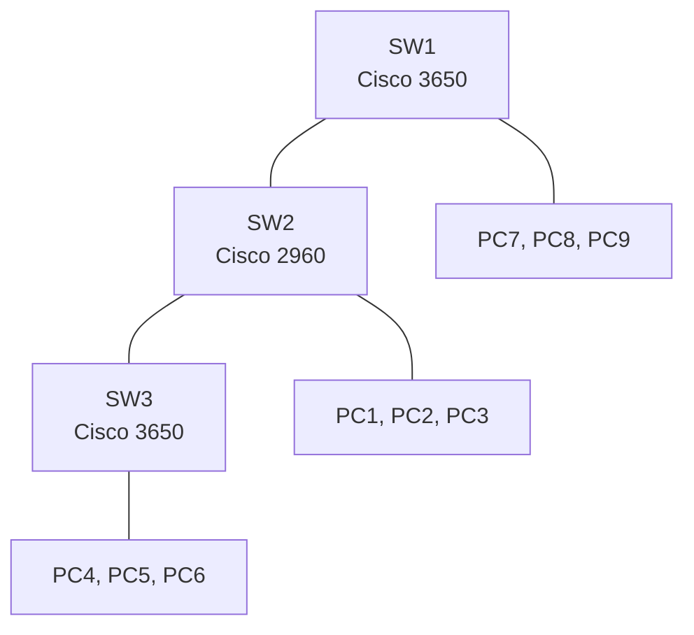

# Project 1: Physical Layer and Ethernet Switching

**Focus:** cabling standards, switch basics, MAC address learning, saving configurations
**Platforms:** Cisco Packet Tracer (Cisco 3650-24PS and 2960-24TT switches), physical Cat 5e/6 cable and RJ45 tools

## Situation

A fictional small company needed its first office network. Before anything else could be built, it needed working cables and a basic switched network in which every computer could reach every other computer, with configurations saved so a power cut would not undo the work.

## What I did

1. **Built cables by hand.** Stripped, ordered, and crimped two cable types, then checked each with a cable tester:
   - **Straight-through** (TIA-568A on both ends), used to connect a computer to a switch.
   - **Crossover** (TIA-568A on one end, TIA-568B on the other), used to connect like devices directly.
2. **Built a single-switch test network** in Packet Tracer: one Cisco 3650 switch, three PCs with static IP addresses, and a console cable for management.
3. **Verified connectivity** with `ping`, then read the switch's MAC address table (`show mac address-table`) to confirm the switch had learned which PC sits on which port.
4. **Saved and documented configurations:** compared `show running-config` with `show startup-config`, recorded `show vlan`, and saved with `copy running-config startup-config`.
5. **Scaled to the company layout:** three switches (two Cisco 3650 and one Cisco 2960 in the middle) and nine PCs, three per switch, with a console connection to each switch.
6. **Tested end to end:** pinged between PCs on different switches, checked each MAC address table, then cleared the tables (`clear mac address-table`) and watched them re-learn.

## Architecture

All nine PCs share one flat network, `10.0.1.0/24` (see the [addressing plan](../docs/addressing-plan.md)).

## Results

- Both cable types passed the cable tester after troubleshooting (see below).
- All nine PCs reached each other across three switches, and every switch's MAC address table showed the expected devices on the expected ports.
- Running configurations were saved to startup so they survive a reboot.

## Key concepts

| Topic | Takeaway |
|-------|----------|
| Cable categories | Cat 5e supports 1 Gb/s at 100 MHz; Cat 6 (250 MHz) and Cat 6a (500 MHz) add tighter twists and better shielding to cut crosstalk. |
| Naming | "Ethernet" is a protocol, not a cable. Cables are named by wiring (straight-through, crossover, rollover) and category. |
| Rollover cable | Used for console management, not for carrying network data. |
| Broadcast vs collision domains | The switches form one broadcast domain (one flat network). Each switch port is its own collision domain. |
| Default VLANs | VLAN 1 is the default. VLANs 1002–1005 are legacy FDDI/Token Ring entries that cannot be removed. Default MTU is 1500 bytes. |

## Troubleshooting summary

| Issue | Root cause | Details |
|-------|-----------|---------|
| MAC address tables stayed empty | Simulator state problem | [troubleshooting](troubleshooting.md) |
| Straight-through cables failed the tester | Uneven wire lengths and too much jacket stripped | [troubleshooting](troubleshooting.md) |
| Crossover cable failed the tester | One wire (brown) in the wrong position | [troubleshooting](troubleshooting.md) |

## Lessons learned

1. **Test cables before blaming configuration.** A bad cable looks like a software problem.
2. **Save early, save often.** Anything not copied to the startup configuration is lost on reboot.
3. **Verify with the device, not just with ping.** The MAC address table shows *where* each device is connected.
