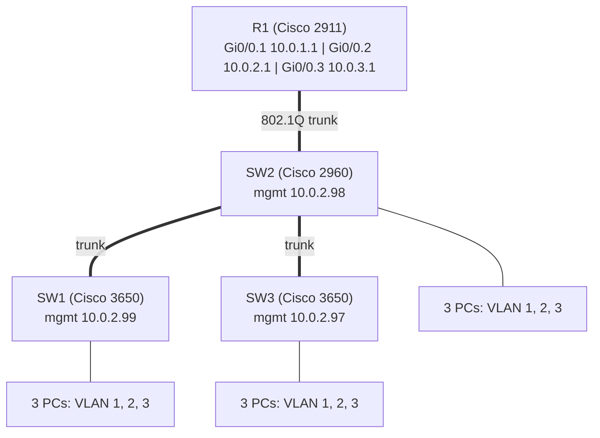

# Project 2: VLANs and Enterprise Router

**Focus:** VLAN segmentation, 802.1Q trunking, inter-VLAN routing, DHCP, SSH management
**Platforms:** Cisco Packet Tracer (Cisco 2911 router, Cisco 3650-24PS and 2960-24TT switches, 9 PCs)

## Situation

The company's single flat network from [Project 1](../01-cabling-and-switching/) meant every broadcast reached every computer and nothing separated one group of users from another. Management also wanted to stop typing IP addresses by hand and to manage network devices remotely instead of walking to each one with a console cable.

## What I did

1. **Created three VLANs** on all three switches and put one PC on each switch into each VLAN, so every switch carries every department.
2. **Trunked the links** between switches and up to the router with 802.1Q, allowing VLANs 1–3.
3. **Added a router-on-a-stick:** one Cisco 2911 router with one physical link to the middle switch and three subinterfaces, one per VLAN, each acting as that VLAN's default gateway.
4. **Configured DHCP on the router:** one pool per VLAN, handing out `.100`–`.200` and excluding the rest for gateways and infrastructure, with DNS supplied to clients.
5. **Gave each switch a management address** on VLAN 2 so it can be reached over the network.
6. **Enabled SSH** on the router and all three switches with a local admin account, and restricted the remote-access lines to SSH only.
7. **Switched all nine PCs to DHCP** and confirmed each received an address in the correct VLAN.

## Architecture

Full addressing is in the [addressing plan](../docs/addressing-plan.md).

## Reference configuration

- [`configs/router-on-a-stick-reference.cfg`](configs/router-on-a-stick-reference.cfg): subinterfaces, DHCP pools, and SSH on the router.
- [`configs/access-switch-reference.cfg`](configs/access-switch-reference.cfg): VLANs, access and trunk ports, management interface, and SSH on a switch.

The lab used SSH version 1 with a 512-bit key and a simple shared password to save time. The references use SSH version 2, a 2048-bit key, and placeholders. They have not been re-tested.

## Results

- One broadcast domain was split into **three**, so each department only hears its own broadcasts.
- All **nine PCs** received correct addresses, gateways, and DNS from DHCP with no manual setup.
- The router and all **three switches** were reachable over SSH (`ssh -l <user> 10.0.1.1` from a PC).
- Every switch carried all three VLANs, so a user can be placed in any department from any switch.

## Key concepts

| Topic | Takeaway |
|-------|----------|
| 802.1Q tag | Inserts 4 bytes between the source MAC and EtherType fields, carrying the VLAN ID and priority. The frame check sequence is recalculated for the longer frame. |
| Broadcast domain | One per VLAN, so three in this design. |
| Contention (collision) domain | One per physical link on a switch. Twelve links meant twelve domains. |
| Native VLAN | Traffic on the native VLAN (VLAN 1 here) crosses the trunk untagged. |

## Lessons learned

1. **Plan the addressing before the configuration.** Gateways, management addresses, and DHCP exclusions all depend on it.
2. **Exclude infrastructure addresses from DHCP** so the router never hands out an address already used by a gateway or switch.
3. **Bring up subinterfaces and the parent interface.** The physical interface must be `no shutdown` for any subinterface to work.
