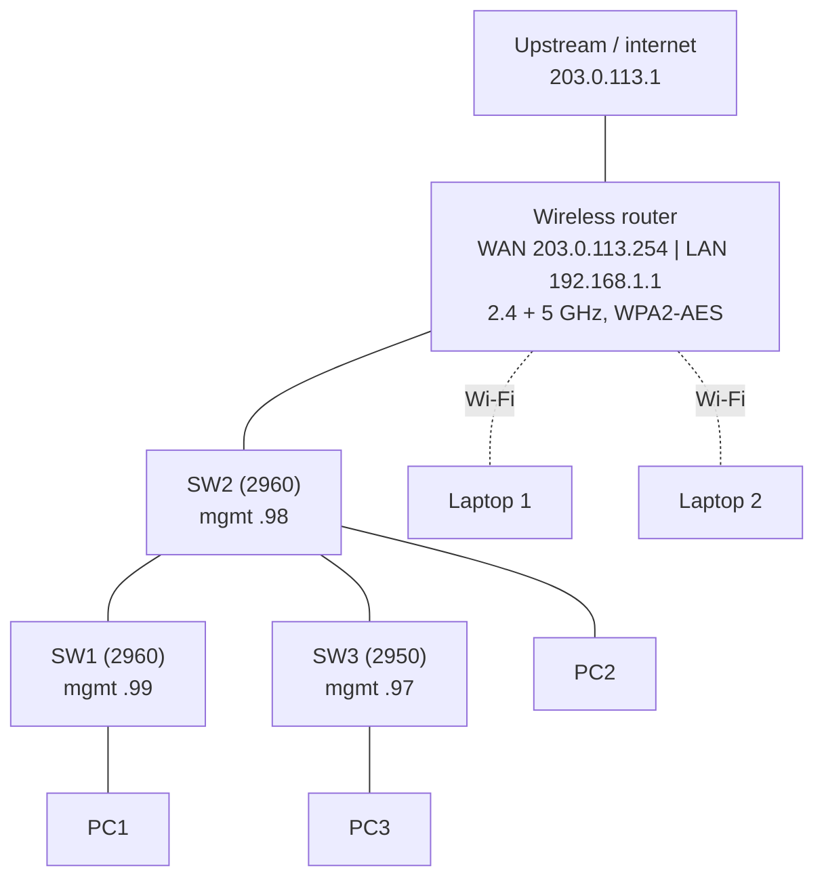

# Project 3: Wireless Network

**Focus:** wireless router setup, Wi-Fi security, channel planning, wired and wireless integration
**Platforms:** Cisco Packet Tracer (wireless home/SOHO router, Cisco 2960-24TT and 2950-24 switches, 3 PCs, 2 laptops)

## Situation

Staff with laptops needed to work away from their desks. The company wanted secure Wi-Fi that shared the same network, internet access, and automatic addressing as the wired PCs, without opening the network to anyone nearby.

## What I did

1. **Built the environment:** a wireless router uplinked to the middle switch, two more switches behind it, one wired PC per switch, and two laptops.
2. **Configured the router's internet (WAN) side** with a static public address and upstream gateway.
3. **Set up the wireless network** on both bands (2.4 GHz and 5 GHz) with a named SSID.
4. **Secured it with WPA2-Personal (AES)** and a strong passphrase on both bands.
5. **Configured DHCP on the router** for the LAN: router at `.1`, clients from `.100`, up to 101 users, with DNS.
6. **Connected the laptops wirelessly:** swapped each laptop's wired network module for a wireless card, then joined the SSID with the passphrase.
7. **Set the wired PCs to DHCP**, and gave each switch a management address and SSH access.

## Architecture

## Wireless design decisions

| Setting | Choice | Reason |
|---------|--------|--------|
| Bands | 2.4 GHz and 5 GHz | 2.4 GHz for range, 5 GHz for speed and less interference |
| 2.4 GHz channel | 1 (with 6 and 11 reserved for additional access points) | 1, 6, and 11 are the only non-overlapping 2.4 GHz channels |
| 5 GHz channel | Auto | 5 GHz has many non-overlapping channels |
| Security | WPA2-Personal, AES, key renewal every 3600 s | WEP is broken and TKIP is deprecated; AES is the secure option |
| SSID broadcast | Enabled | Hiding the SSID only removes it from the list; it is not a security control |

## Results

- Encrypted Wi-Fi was available on **both bands**, and **two laptops** joined it and received addresses automatically.
- All **three wired PCs** received addresses from the same DHCP pool, so wired and wireless users share one network.
- **Three switches** had management addresses and SSH-only remote access.

## Lessons learned

1. **Choose security deliberately.** WPA2 with AES is the minimum; WEP and TKIP should never be used.
2. **Plan channels before adding access points.** Overlapping 2.4 GHz channels cause interference.
3. **Remember the hardware.** A device needs a wireless adapter before any Wi-Fi setting matters.
