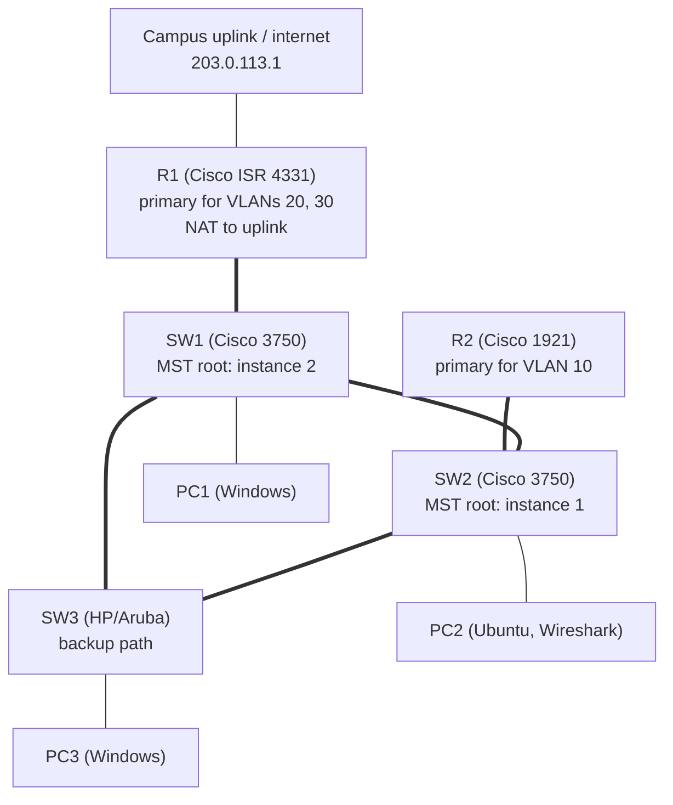

# Project 4: Spanning Tree and Physical Security

**Focus:** moving to real hardware, redundant switching with MSTP, per-VLAN path selection, NAT, switch hardening, packet capture
**Platforms:** Cisco ISR 4331 and Cisco 1921 routers, two Cisco 3750 switches, one HP/Aruba switch, Windows and Ubuntu workstations, PuTTY, Wireshark

## Situation

The simulated network from [Project 3](../03-wireless-network/) had to be replaced with a production-style design on real equipment. Management wanted no single point of failure, two routers sharing the load, remote management of every device, internet access, and tighter physical security: every port labelled and every unused port disabled.

## What I did

1. **Reset all five network devices** to factory defaults, including password recovery through ROMmon on the Cisco routers and switches and a factory reset on the HP/Aruba switch.
2. **Configured both routers:** hostnames, a subinterface per VLAN, DHCP pools, and SSH. R1 (ISR 4331) also got an uplink to the campus network with NAT overload so internal VLANs could reach the internet.
3. **Created VLANs 10, 20, and 30** on all three switches, trunked the inter-switch and router links, and gave each switch a management address and SSH.
4. **Configured Multiple Spanning Tree (MSTP)** on all three switches with a shared region name and revision:
   - Instance 1 (VLAN 10): **SW2** is root, so VLAN 10 traffic flows toward **R2**.
   - Instance 2 (VLANs 20 and 30): **SW1** is root, so that traffic flows toward **R1**.
   - SW3 (HP/Aruba) joins the same region as a backup path if a link or switch fails.
5. **Hardened the switches:** added a description to every used port and shut down every unused port.
6. **Set up three workstations** (two Windows, one Ubuntu), each in its own VLAN, with PuTTY for console and SSH access.
7. **Captured traffic with Wireshark** on the Ubuntu workstation to confirm 802.1Q VLAN tags and spanning tree traffic on the wire.

## Architecture

Link layout simplified for illustration.

## Results

- **Five** network devices (two routers, three switches from two vendors) were reset, configured, and reachable over SSH.
- **Three VLANs** received addresses from DHCP, and network connectivity was confirmed on all three workstations.
- MSTP split traffic across **two instances**, so each router carried its own VLANs while the third switch provided a loop-free backup path.
- **Every unused switch port was disabled** and every used port was labelled.
- Wireshark captures confirmed **802.1Q tags** on trunk traffic.

## Key concepts

| Topic | Takeaway |
|-------|----------|
| Why MSTP | Classic spanning tree blocks redundant links for all VLANs at once. MSTP groups VLANs into instances so each instance can use a different root, which shares load across both routers. |
| Root priority | Lower priority wins. 4096 makes a switch root for an instance; 8192 makes it the backup root. |
| Per-VLAN vs interface statistics | Per-VLAN counters show one department's traffic; interface counters show everything crossing the port. |
| Ingress vs egress | Frames in and out of a port are usually close but not equal, because of broadcasts, drops, and one-way traffic. |

## Troubleshooting summary

| Issue | Root cause | Details |
|-------|-----------|---------|
| A 3750 port would not accept trunk or access commands | The port was in Layer 3 (routed) mode | [troubleshooting](troubleshooting.md) |
| SSH from router to switch failed | Cipher mismatch during the SSH handshake | [troubleshooting](troubleshooting.md) |
| One 3750 switch would not reset or enter ROMmon | Faulty hardware | [troubleshooting](troubleshooting.md) |

## Lessons learned

1. **Configure SSH first.** Once every device is reachable over SSH, the rest of the work no longer depends on console cables and a lab bench.
2. **Test every cable before connecting devices.** Faulty cables cost more troubleshooting time than any configuration error.
3. **Save after every change.** Configurations were lost more than once to power loss before `copy running-config startup-config` became a habit.
