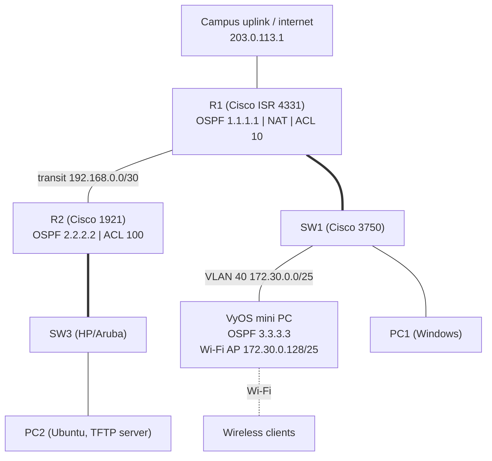

# Project 5: Routing, NAT, and Access Control Lists

**Focus:** dynamic routing with OSPF, NAT, standard and extended ACLs, an open-source router as a wireless access point, Linux network services
**Platforms:** Cisco ISR 4331 and Cisco 1921 routers, Cisco 3750 switch, HP/Aruba switch, VyOS on a fanless mini PC (6 Ethernet ports and Wi-Fi), Windows and Ubuntu workstations

## Situation

With the redundant network from [Project 4](../04-spanning-tree-and-security/) in place, the company wanted routers that find the best path on their own instead of relying on spanning tree, separate address space for each router, a low-cost wireless access point, a file-transfer server for device configurations, and rules that control which users can reach the internet and which can reach the file server.

## What I did

1. **Re-designed the network for routing:** removed MSTP from the switches, gave R2 its own subnets for VLANs 10, 20, and 30, and linked R1 and R2 with a dedicated `/30` transit network.
2. **Enabled OSPF (area 0) on all three routers** (R1, R2, and VyOS) with fixed router IDs. R1 advertises a default route so every router learns the way to the internet.
3. **Configured NAT on R1** so approved internal networks share the uplink address.
4. **Wrote access control lists:**
   - On R1, the NAT list only permits R1's VLANs, the transit link, and the wireless network, so **only approved networks can browse the internet**.
   - On R2, an extended ACL **allows TFTP only from the wireless network** and blocks it from everywhere else, while permitting all other traffic.
5. **Built a wireless access point from a mini PC running VyOS:** flashed the image, configured it over a serial console, then set up an 802.11g access point on channel 6 with WPA2 (CCMP/AES), a DHCP pool for wireless clients, OSPF, and SSH.
6. **Added VLAN 40** on the switch to carry traffic between the VyOS router and R1.
7. **Set up a TFTP server on Ubuntu** (PC2) so devices on the wireless network can send and receive files.

## Architecture

Link layout simplified for illustration. Addressing is in the [addressing plan](../docs/addressing-plan.md).

## Access policy

| Traffic | Policy | Enforced by |
|---------|--------|-------------|
| R1 VLANs, transit link, wireless → internet | Allow (translated with NAT) | R1 NAT list (ACL 10) |
| R2 VLANs → internet | Not translated, so no internet access | R1 NAT list (ACL 10) |
| Wireless clients → TFTP (UDP 69) | Allow | R2 extended ACL 100 |
| Anything else → TFTP | Deny | R2 extended ACL 100 |
| All other internal traffic | Allow, routed by OSPF | — |

## Reference configuration

- [`configs/r1-ospf-nat-acl-reference.cfg`](configs/r1-ospf-nat-acl-reference.cfg): R1 OSPF, default-route origination, NAT, and ACL 10.
- [`configs/r2-ospf-acl-reference.cfg`](configs/r2-ospf-acl-reference.cfg): R2 OSPF, DHCP, and the TFTP ACL.
- [`configs/vyos-wireless-ap-reference.cfg`](configs/vyos-wireless-ap-reference.cfg): VyOS access point, DHCP, OSPF, and SSH.
- [`configs/tftp-server-ubuntu.md`](configs/tftp-server-ubuntu.md): TFTP server setup on Ubuntu.

## Results

- **Three routers from two vendors** (Cisco and VyOS) formed OSPF neighbors and learned every network automatically, including a default route to the internet.
- Internet access was **limited to approved networks**, and TFTP was **limited to wireless clients**.
- A **fanless mini PC became a WPA2 wireless access point** with its own DHCP pool, routed into the rest of the network.
- Both workstations received addresses by DHCP, and a **TFTP server** on Ubuntu was set up for file transfers with wireless clients.

## Troubleshooting summary

| Issue | Root cause | Details |
|-------|-----------|---------|
| OSPF mismatch errors and no neighbors on R1 | OSPF area not applied to the uplink interface | [troubleshooting](troubleshooting.md) |
| Wireless traffic never reached R1 | VLAN 40 missing from the trunk's allowed VLAN list | [troubleshooting](troubleshooting.md) |
| VyOS kept old configuration after re-flashing | Previous config persisted on the device | [troubleshooting](troubleshooting.md) |

## Lessons learned

1. **Wipe before you build.** After installing VyOS, load the default configuration first so old settings do not cause confusing behavior.
2. **When a new VLAN "does nothing," check every trunk.** A VLAN must be allowed on each trunk along its path.
3. **Read ACLs left to right.** In `permit udp <source> <wildcard> eq 69`, the port belongs to the source. The destination port goes after the destination.
4. **Test cables and save configurations,** the same habits that paid off in Project 4.
