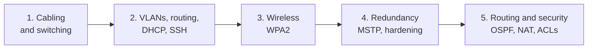

# Network Engineering Fundamentals

> **Please read the [DISCLAIMER](DISCLAIMER.md).** This work comes from team lab projects in a university networking course. I am not the sole author or owner of it, and this repository is a sanitized, re-written summary for educational and portfolio purposes.

## In one sentence

Starting from a handful of cables and computers, I helped build a small company network one step at a time until it had separate departments, Wi-Fi, backup paths, internet access, and security rules, and I documented every problem we hit and how we fixed it.

## Executive Summary

**Situation.** A fictional small company needed an office network, and its requirements grew with each project: first basic connectivity, then separate departments, then wireless access, then protection against outages, and finally efficient routing with controlled internet access.

**What I did.** Over five projects, I built and configured the network on real Cisco and HP/Aruba equipment and in Cisco Packet Tracer simulation. Each project extended the one before it:

1. **Cabling and switching:** made and tested network cables by hand, then connected and verified nine computers across three switches.
2. **Departments and automatic addressing:** divided the network into three separate virtual networks (VLANs), routed between them with one router, handed out addresses automatically (DHCP), and enabled secure remote management (SSH).
3. **Wireless:** added an encrypted Wi-Fi network (WPA2) on 2.4 GHz and 5 GHz for laptops alongside the wired PCs.
4. **Redundancy and physical security:** rebuilt the network on real hardware with two routers and three switches, added backup paths that cannot loop (Multiple Spanning Tree), shut every unused switch port, and checked traffic with Wireshark.
5. **Routing, internet access, and access control:** made routers find the best path on their own (OSPF), shared one public address for internet access (NAT), limited who can reach what (access control lists), and turned a small Linux PC into a secure wireless access point (VyOS).

**Results.**

| Project | Business need | Outcome |
|---------|---------------|---------|
| 1. Cabling and switching | "Get our computers talking." | 2 cable types built and passed a cable tester; 9 PCs on 3 switches reached each other |
| 2. VLANs and DHCP | "Keep departments separate, and stop setting IPs by hand." | 3 departments isolated; 9 PCs received addresses automatically; 4 devices manageable over SSH |
| 3. Wireless | "Our laptops need Wi-Fi." | Encrypted dual-band Wi-Fi; 2 laptops and 3 wired PCs online with automatic addressing |
| 4. Redundancy | "One failure should not take us down." | 5 production-class devices configured; backup paths with no loops; all unused ports disabled; VLAN tags confirmed in packet captures |
| 5. Routing and security | "Route efficiently, reach the internet, and control access." | 3 routers sharing routes automatically; internet access limited to approved networks; file transfers limited to wireless users; Wi-Fi access point built from a Linux PC |

**Skills demonstrated:** network design, cabling standards (TIA-568A/B), switching and VLANs, inter-VLAN routing, DHCP, SSH, wireless security, spanning tree (MSTP), OSPF, NAT, access control lists, VyOS, Linux services (TFTP), Wireshark, and documented troubleshooting.



## Projects

| # | Project | Technologies | Key outcome |
|---|---------|--------------|-------------|
| 1 | [Physical Layer and Ethernet Switching](01-cabling-and-switching/) | Cat 5e/6 cabling, TIA-568A/B, Cisco 3650/2960, Packet Tracer | Hand-built cables and a verified three-switch LAN |
| 2 | [VLANs and Enterprise Router](02-vlans-and-routing/) | 802.1Q, router-on-a-stick, Cisco 2911, DHCP, SSH | Three isolated VLANs with routing and automatic addressing |
| 3 | [Wireless Network](03-wireless-network/) | Wireless router, 2.4/5 GHz, WPA2-AES, DHCP | Secure Wi-Fi integrated with the wired LAN |
| 4 | [Spanning Tree and Physical Security](04-spanning-tree-and-security/) | Cisco ISR 4331, Cisco 1921, Cisco 3750, HP/Aruba, MSTP, NAT, Wireshark | Loop-free redundant design on real hardware |
| 5 | [Routing, NAT, and ACLs](05-routing-nat-acl/) | OSPF, NAT/PAT, standard and extended ACLs, VyOS, Ubuntu TFTP | Dynamic routing with controlled internet and service access |

## Repository layout

```
.
├── DISCLAIMER.md
├── docs/            # plain-English glossary, addressing plan, skills matrix
├── 01-cabling-and-switching/
├── 02-vlans-and-routing/
├── 03-wireless-network/
├── 04-spanning-tree-and-security/
└── 05-routing-nat-acl/
```

Each project folder has a `README.md` written as **Situation → What I did → Results**. Projects 1, 4, and 5 also have a `troubleshooting.md`, and Project 5 has reference configurations in `configs/`.

New to networking terms? Start with the [plain-English glossary](docs/glossary.md).

## Conventions

- Public-side addresses use `203.0.113.0/24` (RFC 5737 documentation range). Private ranges use RFC 1918 space.
- Hostnames are generic (`R1`, `SW1`, `PC1`), and VLAN IDs are renumbered to 10, 20, 30, and 40. See the [addressing plan](docs/addressing-plan.md).
- Passwords, keys, and SSIDs appear as `<PLACEHOLDERS>`.
- **Reference configuration** marks a normalized configuration written for this portfolio. Verify against current vendor docs before use.
